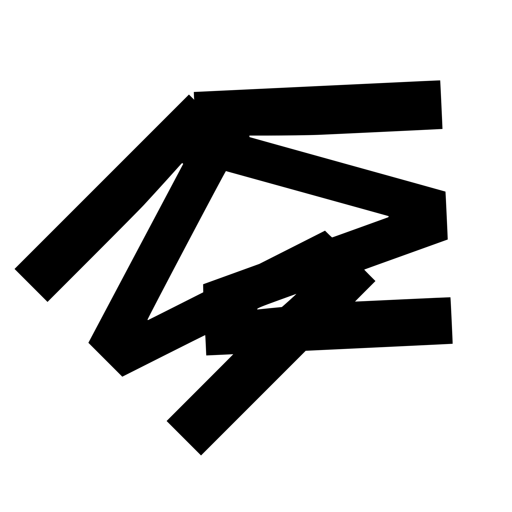

# Musika

<p align="center">
  
</p>

Musika is a Keyboard driven Navidrome/Subsonic Client made with AI assistance. Written in Rust and QT. It contains many functionalities, such as _vi motions_, _cache & download system_, an indexed db based search, caching in covers, and other performance extras. Everything is thoroughly tested by me. Mostly coding is made by AI and me.

# Features

1 - Alt-Menu -- A multipoint(Alt) call for Tracks, Albums. Which is capable of transporting through other sections, or executing context-driven actions (like bulk-download, favoriting, etc;). Four quadrants: Add to Queue (N), Favorite (S), Go to Artist (W), Go to Album (E — on an album row the east slot carries the download toggle instead), aimed with `h/j/k/l` or the arrows (mouse works too), fired on Alt release, cancelled by Esc or a neutral aim. With a visual selection up (`v`/`V`) the verbs apply to the whole range, including a bulk **Download** that toggles: a selection already cached is removed instead.

2 - Download System -- Local-first, two ledgers in `media.db` and two tiers: the artifact tables own the blobs + the container *rules*, the download ledger owns the intent and progress (queued → active → done/error). An explicit song download is `permanent`; selecting an album or an artist writes a rule, downloads every existing track and keeps catching new ones on sync — toggling it off removes the rule and its files. Permanent/rule blobs live under `~/.config/musika/media`, the purgeable playback tier under `~/.cache/musika/media`. Row glyphs show the state (outline → spinning loop → filled), and offline mode serves the downloaded catalog only.

3 - Search -- `/` searches the surface in front of you (literal, smartcase, viewport-scoped) with in-place match blocks and `[i/N]` counts; Enter jumps, Esc abandons. The global overlay uses a hybrid search (ARC-SEARCH): the in-process Nucleo fuzzy index answers first, and SQLite FTS5 fills any column that comes back short. `MUSIKA_SEARCH_ENGINE=nucleo` or `fts` pins one engine. The fuzzy catalog is held to a memory budget (`MUSIKA_SEARCH_INDEX_BUDGET_MIB`, 64 MiB by default); a library past it is searched by FTS instead, and `0` restores the old unlimited catalog.

4 - Playback -- a native libpipewire sink and raw FFmpeg decoder FFI drive playback: queue order, repeat, seek/volume, native MPRIS, stream-error advance, and synced lyrics (OpenSubsonic) that ride the shared scroll body. The current track is buffered in memory before decoding, so streaming seeks stay in RAM instead of reconnecting to the server.

5 - Covers, lyrics and palettes are each cached in their own DB and purged on sync — nothing derived is fetched twice.

# Installation

Currently, it's a nix flake based installation; However, I plan in the future to provide another packaging schemes for MUSIKA. The flake installation follows as below:

in yer flake inputs.

```
musika.url = "github:rPlakama/musika";

```

then as a user/system package.

```
inputs.musika.packages.${pkgs.system}.default
```

# Sections

- Library scopes: Albums, Songs, Artists, Playlists (Radio is a placeholder). Shift-J/K cycles the scope; Shift-H/L cycles the ordering.
- Fullscreen player (Enter on a song): transport, seek, volume, and the lyrics pane.
- Queue drawer (`Ctrl-Q` slides it in from any view, library or fullscreen): `j/k`, Enter jumps, `Ctrl-Shift-J/K` reorder, `dd` removes, `q` or `Ctrl-Q` closes (Esc is a vi key and only ends a visual selection).
- Clipboard: `y`/`Y` yank the cursor row (or the visual range) from any list — Albums, Songs, Artists, album/artist pages, search and the queue — into the row clipboard; `p`/`P` paste it below/above the cursor in the open queue drawer. `Ctrl-N`/`Ctrl-P` skip tracks anywhere.
- Search overlay: hybrid Nucleo + FTS5 browser (`MUSIKA_SEARCH_ENGINE=nucleo` or `fts` pins one engine).

# Binds

Musika is keyboard-first. The keymap is Vim-flavoured: bindings can be sequences (`g g`), motions take a count prefix (`3j`, `10l`, `5G`), and a half-typed sequence times out after 800 ms.

## Global

| Keys | Action |
| --- | --- |
| `Space` | Play/pause |
| `Ctrl-N` / `Ctrl-P` | Next / previous track |
| `,` / `.` | Seek back / forward 5 s |
| `-` / `=` (`+`) | Volume down / up 5% |
| `m` | Mute |
| `Ctrl-R` | Cycle repeat (off → all → one) |
| `r` | Sync the library |
| `Shift-Enter` | Toggle the fullscreen player |
| `Ctrl-Q` | Toggle the queue drawer |
| `?` | Toggle the lyrics overlay in fullscreen |
| `[b` / `]b` | Previous / next place in the travel log |
| `Shift-Q` | Home: close overlays, leave fullscreen and pop every page |
| `q` | Back; at Home press it twice to quit |
| `Esc` / `Ctrl-[` | Cancel and hierarchical Back |
| `1`–`9` prefix | Count for the next motion or action |

## Lists and pages

| Keys | Action |
| --- | --- |
| `j` / `k` | Move the cursor down / up |
| `h` / `l` | Move left / right between panes where a surface has them |
| `g g` / `G` | Jump to the first / last row |
| `Ctrl-D` / `Ctrl-U` or `PageDown` / `PageUp` | Page down / up |
| `v` / `V` | Toggle visual selection / select all rows |
| `Shift-↑` `Shift-↓` `Shift-←` `Shift-→` | Extend the visual selection |
| `y` / `Y` | Yank the visual range (or cursor row) / the cursor row |
| `p` / `P` | Paste the row clipboard below / above the queue cursor |
| `Ctrl-V` | Paste text into the focused search field |
| `Enter` | Open/play the row, confirm, or use the focused control |
| `Tab` / `Shift-Tab` | Walk panes, header stops and status-bar actions |
| `Shift-J` / `Shift-K` | Next / previous library scope (Albums, Songs, Artists, Playlists, Radio) |
| `Shift-L` / `Shift-H` | Next / previous list ordering |
| `/` | In-surface line search |
| `Shift-Space F` or `i` | Open the floating search |
| Mouse click | Place the cursor and open/play the row |
| `Shift` + click | Extend the visual selection to the row |
| Mouse Back / Forward | Previous / next place in the travel log |

On the album page, `Tab` cycles the cover, artist link, notes and Back chip; `j`/`k` then move through the song rows. On the artist page it cycles the title, biography, shuffle and album wall.

## Queue drawer

| Keys | Action |
| --- | --- |
| `j` / `k`, `g g` / `G`, `Ctrl-D` / `Ctrl-U`, `PageDown` / `PageUp` | Move through the queue |
| `Enter` | Jump to the cursor track |
| `Ctrl-Shift-J` / `Ctrl-Shift-K` | Move the track down / up |
| `d d` | Remove the cursor track (removes the whole range in visual mode) |
| `v` / `V`, `Shift-arrows` | Select rows / select all |
| `y` / `Y`, `p` / `P` | Yank the range or row / paste below or above |
| `q` or `Ctrl-Q` | Close the drawer |
| `Esc` / `Ctrl-[` | End the visual selection (does not close the drawer) |

## Fullscreen player

| Keys | Action |
| --- | --- |
| `Tab` / `Shift-Tab` | Cycle the album and lyrics panes (lyrics is skipped while hidden) |
| `j` / `k`, `Ctrl-D` / `Ctrl-U`, `PageDown` / `PageUp` | Scroll the lyrics pane |
| `h` / `l` | Move between the lyrics and album panes |
| `Enter` | Open the current album or track actions |
| `?` | Toggle the floating lyrics overlay |
| `Esc` / `Ctrl-[` | Close the lyrics overlay, otherwise leave fullscreen |

## Floating search

| Mode | Keys | Action |
| --- | --- | --- |
| Typing | text | Filter the current scope |
| Typing | `Ctrl-H` / `Ctrl-L`, `Tab` / `Shift-Tab`, `Ctrl-Backspace` | Previous / next scope |
| Typing | `↑` / `↓` or `Ctrl-P` / `Ctrl-N` | Previous / next result row |
| Typing | `Enter` | Open/play the result |
| Typing | `Ctrl-W` | Delete the previous word |
| Typing | `Esc` | Leave typing for normal mode |
| Normal | `h` / `l`, `Tab` / `Shift-Tab`, `Shift-H` / `Shift-L`, `Shift-J` / `Shift-K` | Previous / next scope |
| Normal | `j` / `k`, `g g` / `G`, `Ctrl-D` / `Ctrl-U`, `PageDown` / `PageUp` | Move through the results |
| Normal | `v` / `V`, `Shift-arrows` | Select / extend the selection |
| Normal | `y` / `Y` | Yank the range or row into the row clipboard |
| Normal | `i` | Return to typing |
| Normal | `Enter` | Open/play the result |
| Normal | `Esc` / `Ctrl-[` | Clear the selection first, then close the search |

## Line search (`/`)

| Keys | Action |
| --- | --- |
| text | Literal, smartcase search over the visible surface |
| `Tab` / `Shift-Tab`, `Ctrl-L` / `Ctrl-H`, `Ctrl-Backspace` | Next / previous match |
| `Enter` | Commit the current match |
| `Esc` | Abandon the search |
| `Ctrl-W` | Delete the previous word |

## Alt quick actions

| Keys | Action |
| --- | --- |
| Hold `Alt` | Open the quick-action menu on the cursor row |
| `h` / `j` / `k` / `l` or the arrow keys | Aim west / south / north / east |
| `Shift-J` / `Shift-K` | Step the aimed favourite's rating up / down |
| Release `Alt` | Fire the aimed action; release over the neutral centre cancels |
| Click a tile / click outside | Fire a tile / cancel a sticky menu |

While `Alt` is held, `Esc` is swallowed so it cannot leak into the keymap; the neutral release is the cancel. Sticky menus (the trashcan wipe menu) aim with `h`/`j`/`k`/`l` or the arrows and fire with `Enter`; `Enter` on the neutral centre or a click outside closes them.

# Building

```
nix run .       # build + launch
nix develop     # dev shell (Rust + Qt)
```

The native player links PipeWire and FFmpeg development libraries; the flake
provides both.

To benchmark startup, build a release binary and trace the phases:

```
nix develop -c cargo build --release
MUSIKA_STARTUP_TRACE=1 MUSIKA_STARTUP_EXIT=1 ./target/release/musika
```

`MUSIKA_STARTUP_TRACE=1` prints the six process-relative marks (`main`,
`db.init`, `session.restore`, `qapp.new`, `qml.loaded`, `frontend.ready`) to
stderr; `MUSIKA_STARTUP_EXIT=1` closes the window after the first rendered
frame, so the whole run can be timed with `hyperfine`. Neither variable costs
anything when unset.

# Contributions

Pull Requests are welcome if properly tested. I have no issues with AI -- since it would be hypocritical. Besides that, the development is nix-first, as my favorite development tool. Besides that, many core tools, which are present in other players, still missing from here, and bugs that I haven't caught yet. Opening an issue for any problem is also very welcome.

GPL-2.0-or-later.

# Module Cross-Talk

> Directed edges = `crate::` references found by static analysis across every source file (tests excluded).
> Source: [`docs/imgs/module_cross_talk.gv`](docs/imgs/module_cross_talk.gv)

<p align="center">
  
</p>
