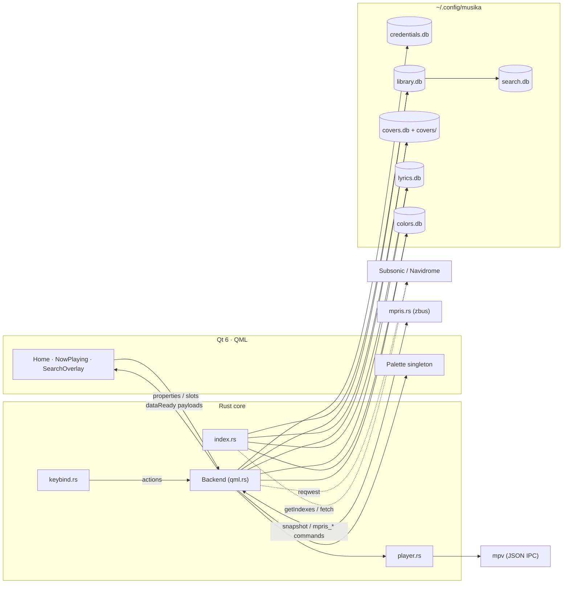

# Musika

A keyboard-driven Subsonic/Navidrome client for Linux — native Rust core, Qt 6/QML
interface, and **vi muscle memory everywhere**. Built for people who browse a
music library the way they browse a buffer.

> Space plays. `hjkl` moves. `:` is coming. Strawberry is great; this is for
> living inside the keyboard.

## At a glance

| Layer | What it is |
|---|---|
| **Core** | Rust 2024 (`qtbridge` registers the QML backend) |
| **Shell** | Qt 6.11 / QML — one `ApplicationWindow`, vi focus regions |
| **Playback** | `mpv` subprocess + JSON IPC (position, duration, pause, volume, mute) |
| **Source** | Subsonic API 1.16.1 + OpenSubsonic extensions (`songLyrics`) |
| **Storage** | Six SQLite databases under `~/.config/musika/`, WAL, one writer domain each |
| **Theme** | Cover-seeded Material You (matugen-style, `material-colors` crate) |
| **Distribution** | Nix flake (wrapped binary: Qt env + `mpv` on `PATH`) |

## Structure

```
src/
├── main.rs         QApp bootstrap; embeds QML + SVG resources (include_bytes_qml!)
├── qml.rs          Backend singleton — every QML property/slot lives here
├── player.rs       mpv supervisor, queue, IPC reader, volume/mute
├── api.rs          Subsonic/OpenSubsonic endpoints and response types
├── http_client.rs  one blocking client behind the async runtime
├── index.rs        sync orchestration: library → search → covers → lyrics
├── library.rs      library.db (artists/albums/songs) + browse queries
├── search.rs       search.db — FTS5 over song metadata
├── covers.rs       covers.db + covers/ blobs (etag/hash revalidation)
├── lyrics.rs       lyrics.db — override → cache → getLyricsBySongId → legacy
├── colors/         palette engine (seed → spec → roles) + colors.db
├── palette.rs      Palette singleton — QML reads live role colors
├── keybind.rs      sequence-aware keymap + Qt key tokens
├── ipc.rs          Unix-socket command pump (`~/.config/musika/ipc.sock`)
├── db.rs           the six pools, paths, WAL/busy-timeout/FK setup
├── crypto.rs       AES-256-GCM for stored credentials
└── qml/            QML components (Theme.js, NowPlaying, SearchOverlay, …)
```

Modules are one-per-domain: a new feature is a new file (or QML component) —
the QML directory is embedded at build time, and QML components are drop-in.

## Databases (disposable by design)

```
DB1  credentials.db   encrypted account — the only data worth backing up
DB2a library.db       artists / albums / songs, rebuilt from the server
DB2b search.db        FTS5 index, rebuilt from library.db
DB3  covers.db        cover-art index; blobs in covers/
DB4  media.db         offline audio cache (planned, CACHE-1)
DB5  lyrics.db        lyrics + line timings, TTL + purge-on-sync
DB6  colors.db        cover-seeded schemes, revalidated by cover hash
```

Every cache is independent: separate pool, separate WAL, separate purge domain.
Delete any of them and the app rebuilds it; reads never wait on the sync writer.
Purging only ever happens **after a fully successful sync** (a failed fetch
cancels the destructive phase — ARC-25).

## Sync

```
getIndexes(ifModifiedSince) ─► library.db (single transaction)
          │
          ├─► search.db   full FTS reconstruction
          ├─► covers.db   conditional revalidation + orphan purge
          ├─► lyrics.db   bounded backfill (misses cached with a TTL)
          └─► colors.db   schemes for vanished covers purged
```

All caches also revalidate lazily: covers by etag/hash, plain lyrics after a
TTL, color schemes against the cover hash + generator tag.

## Search

Two indexes answer one query:

- **Songs** come from `search.db` — an FTS5 table with its own pool and WAL,
  rebuilt wholesale after each successful library sync. Input is tokenised on
  whitespace and every token is quoted and prefix-matched (`"radio"*`), so FTS
  operators typed by accident stay literal and partial words match while
  typing; results come back `ORDER BY rank`.
- **Artists and albums** come from `library.db` with an escaped `LIKE` over
  `name` (albums also match `artist`), so they need no second index.

`Backend.requestSearch()` runs all three reads plus cover resolution in one
worker task and publishes `dataReady("search", {artists, albums, songs})`
(20 per category). The UI is the floating overlay (`SearchOverlay` +
`SearchColumn`): 120 ms debounce, three weighted columns (Songs | Albums |
Artists), skeleton while in flight, and a Songs-first lookup priority
(Songs → Albums → Artists) for the initial cursor.

Activating a song goes through the same command pump as external IPC
(`play_song_in_album <id>`): the backend queues the album starting at that
song and emits the album metadata, and Home opens the album page while
playback continues through the album.

## Sort

Album order is a small closed set instead of free-form SQL:

```rust
library::ALBUM_ORDERS = ["Artist", "Name", "Year"]
```

Each label maps to static `ORDER BY` clauses selected by a `match` on
`(filter?, order)` in `library::albums()` — no string interpolation, so the
allowlist is enforced at the type level (`Year` sorts `DESC, name` for ties).
`Shift-L` / `Shift-H` call `cycle_album_order()` on the Backend, which
publishes the `albumOrder` property (with notify) and re-requests the list;
the live label is rendered in the order hint. The artist filter is the same
query with `WHERE artist = ?1`.

## API

`http_client.rs` is the only transport: one `reqwest` client behind the async
runtime, with every call built through `endpoint_url()` so the Subsonic auth
parameters are uniform:

```
u=username  t=md5(password + salt)  s=salt  v=1.16.1  c=musika  f=json
```

The password itself never crosses the wire, and a fresh salt/token is generated
per request. Responses are parsed as `subsonic-response` envelopes whose
`status`/`error` flatten into the typed body, so server error messages surface
as `Err` instead of an empty struct.

`api.rs` layers the typed surface on top — `getIndexes(ifModifiedSince)` and
ID3 `getArtist`/`getAlbum` for sync, `stream` for playback, `getCoverArt`,
`star`/`scrobble`, `getLyrics`/`getLyricsBySongId`,
`getOpenSubsonicExtensions`, and more. Serde structs use `camelCase` renames
plus a `one_or_many` helper, because Subsonic servers return a bare object
where an array is expected when a result set has a single entry.

Three details are load-bearing:

- **Streaming**: `stream_url()` is handed to `mpv` over its own JSON IPC
  socket, never as a process argument — credentials stay out of `ps`/`/proc`.
- **Cover art**: `get_cover_art()` sends `If-None-Match`/`If-Modified-Since`
  and short-circuits on `304`, which is what keeps revalidation cheap.
- **Capabilities**: OpenSubsonic support is probed once via
  `getOpenSubsonicExtensions`; the `songLyrics` extension decides whether
  `getLyricsBySongId` is attempted before the legacy `getLyrics` fallback.

## Lyrics

Resolution order: local override (`~/.config/musika/lyrics/<song_id>.lrc`) →
DB5 cache → OpenSubsonic `getLyricsBySongId` → legacy `getLyrics` (raw `.lrc`
text is parsed, not dumped). Synced documents drive a centred stage —
active line scaled/bright, neighbours dimmed by distance, auto-follow paused
while you scroll.

## Colors

The playing cover seeds a Material You dark scheme (112 px quantise → score →
`DynamicScheme`), cached per cover. Specs `2021`, `2025` and `dms` parity are
selectable; source modes are `dominant`, `colorful` and a `#rrggbb` override.
`Palette` applies the roles live to the whole UI. Generation is play-scoped:
browsing never paints a palette.

## Keymap

| Scope | Keys |
|---|---|
| Movement | `h j k l`, `g g` top, `G` bottom |
| Navigate | `Tab` pane cycle, `Ctrl-W` scope overlay, `Enter`, `Esc`/`q`/`Ctrl-[` back |
| Playback | `Space` play/pause, `n`/`p` or `Ctrl-N`/`Ctrl-P` next/prev, `m` mute, `-`/`+` volume |
| Library | `Shift-H`/`Shift-L` list order (Artist → Name → Year): albums, or songs in the Songs segment |
| Clipboard | `y` yank the playing track, `Shift-P`/`Ctrl-V` paste into search |
| Queue | `Ctrl-Q` drawer, `Shift-J`/`Shift-K` or `Alt-J`/`Alt-K` reorder, `d d` remove, `Enter` jump |
| Search | `Shift Space F` floating search, or `i` to start typing (Songs | Albums | Artists) |

Fullscreen (`Shift-Enter`) adds a lyrics/queue split with its own pane keybar.
Playing a row in the Songs segment stays in the list and queues the library
from that row in 200-track windows; while you listen, each extension pre-loads
up to 5 more tracks once 10 remain. Search hits and album pages open
fullscreen instead.

## IPC

Every key action is also a command on the Unix socket — scripts and desktop
shells (niri, Noctalia, …) drive the player with the same vocabulary:

```sh
echo queue_toggle | socat - UNIX-CONNECT:~/.config/musika/ipc.sock
echo "play_song_in_album 5LEeV6Y9AG6XLqvuYwIL7d" | socat - "$SOCK"
echo colors_refresh | socat - "$SOCK"
```

## MPRIS

The player owns `org.mpris.MediaPlayer2.musika` on the session bus (zbus, tokio
task; nothing on the Qt thread), so panels, media keys, lock screens and
`playerctl` work on a stock desktop. Transport, Volume, Metadata
(`mpris:trackid`, `mpris:length`, `mpris:artUrl`, `xesam:*`) and a rate-limited
`PropertiesChanged` are exposed; MPRIS controls re-enter through the same
dispatcher as keys and IPC. Without `DBUS_SESSION_BUS_ADDRESS` the service logs
once and no-ops; setting `MUSIKA_MPRIS_SCRIPT` disables it in favour of the
`mpv-mpris` script (single node either way).

```sh
playerctl -p musika status          # Playing / Paused / Stopped
playerctl -p musika metadata        # title, artist, length, artUrl
playerctl -p musika play-pause
```

## Running

```sh
nix develop     # Rust, Qt 6, mpv, sqlite, rust-analyzer
cargo run       # development build (QML embedded at compile time)

nix build       # wrapped release binary
nix run .       # same, straight from the flake
```

`mpv` is required at runtime; the Nix wrapper puts the right Qt environment and
`mpv` on `PATH`. First launch shows the login screen; credentials are encrypted
with a key at `~/.config/musika/key` (AES-256-GCM).

### Environment overrides

| Variable | Effect |
|---|---|
| `MUSIKA_{CREDENTIALS,LIBRARY,SEARCH,COVERS,LYRICS,COLORS}_FILE` | database paths |
| `MUSIKA_COVERS_DIR` | cover blob directory |
| `MUSIKA_IPC_SOCKET` | command socket path |
| `MUSIKA_KEY_FILE` | credential encryption key |
| `MUSIKA_MPRIS_SCRIPT` | opt-in `mpv-mpris` fallback; disables the native MPRIS service |
| `MUSIKA_COLOR_{VARIANT,CONTRAST,SOURCE,SPEC}` | palette knobs |

## Modules cross-talk



## Docs

`TASKLISTMAJOR.md` is the master task list (priorities, coverage, solved
evidence). Design rationale lives in the local notes (`roadmap.md`,
`materialyou3idea.md`, `POLISHAUDIT.md`, `DB*.md`) — kept intentionally out of
git; only the major list is tracked.

## License

GPL-2.0-or-later. Every source file carries the FSF copyright/warranty notice.
